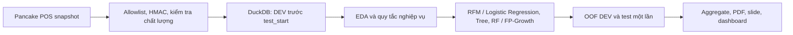

# Tài liệu ôn vấn đáp — Xoaif Garden

> Bản ôn tập được đối chiếu với kế hoạch cuối, notebook đã lưu, PDF slide và các artifact tổng hợp trong repo. Kế hoạch được dùng thay đề bài theo chỉ dẫn của người học. Những con số bên dưới chỉ áp dụng cho cohort ghi rõ, không tráo snapshot, DEV, OOF và test.

## Mục lục

1. [A. Bức tranh tổng thể](#a-bức-tranh-tổng-thể)
2. [I. Cảnh báo rủi ro](#i-cảnh-báo-rủi-ro)
3. [B. Dữ liệu và đặc trưng](#b-dữ-liệu-và-đặc-trưng)
4. [C. Thuật toán và khái niệm](#c-thuật-toán-và-khái-niệm)
5. [D. Kết quả và cách diễn giải](#d-kết-quả-và-cách-diễn-giải)
6. [E. Rà soát từng slide](#e-rà-soát-từng-slide)
7. [F. Ngân hàng 80 câu hỏi](#f-ngân-hàng-80-câu-hỏi)
8. [G. Tờ ôn nhanh](#g-tờ-ôn-nhanh)
9. [H. Thực hành vấn đáp](#h-thực-hành-vấn-đáp)
10. [Nguồn trong dự án](#nguồn-trong-dự-án)

## A. Bức tranh tổng thể

### A1. Dự án làm gì?

Xoaif Garden xây quy trình phân tích bán hàng từ Pancake POS: thu thập snapshot, kiểm tra và lưu dữ liệu vào DuckDB, tạo tổng hợp phát triển, sau đó dùng phân khúc RFM, phân loại khả năng mua lại và luật kết hợp sản phẩm. Dashboard và báo cáo chỉ hiển thị aggregate. Ba câu hỏi là: khách hiện có khác nhau thế nào theo lịch sử mua; có tín hiệu xếp hạng khách mua lại trong 180 ngày kế tiếp không; sản phẩm nào thường xuất hiện cùng giỏ? Nhánh phân loại phản hồi và hủy/hoàn bị loại vì dữ liệu/nhãn không đạt điều kiện; DBSCAN địa lý không chạy vì không có tọa độ hoặc mã vùng phù hợp. [Kế hoạch cuối, §1; Notebook 03–05, ô 0–2; Slide 2, 8, 11–12, 14]

Phân khúc là **không giám sát**: K-Means nhóm khách theo RFM để mô tả. Mua lại là **có giám sát**: nhãn nhị phân được xác định sau mốc T. Luật kết hợp là khai phá giỏ, không phải dự đoán nhân quả. Mục tiêu là phân tích có thể kiểm tra, không phải chứng minh chiến dịch sẽ tăng doanh thu.

### A2. Luồng dự án

| Bước | Trong dự án | Nguồn kiểm chứng |
|---|---|---|
| Dữ liệu thô và snapshot | Nhiều bảng giao dịch trong cùng Pancake POS; snapshot `20261024T052943Z`, 12.011 đơn / 601 trang. Lịch ngày lễ công khai chỉ là ngữ cảnh thời gian, không phải hệ thống giao dịch độc lập. | `docs/canonical_numbers.md`; `docs/holiday_time_supplement.md`; Slide 1–3 |
| EDA | Dữ liệu DEV, ngày trước 2025-10-22; kiểm tra tháng, trạng thái, khách và số sản phẩm | Notebook `01_day1_development_eda.ipynb`, ô 1–5; `01b_eda_dev.ipynb` |
| Tiền xử lý | Mốc cửa hàng 2024-04-01, status 3, loại đơn quà, quy tắc thời gian; HMAC khóa định danh | Notebook `02_preprocess.ipynb`, ô 0–2; `docs/data_protocol.md` |
| Chia tập | DEV trước test; temporal expanding folds và khoảng đệm N+L; test `[2025-10-22, 2026-04-20)` đã mở một lần | Notebook `03_supervised.ipynb`; `docs/test_provenance_note.md`; Slide 4, 8–10 |
| Mô hình | Logistic Regression, Decision Tree, Random Forest; K-Means; FP-Growth | Notebook 03–05; Slide 8–12 |
| Đánh giá | PR-AUC trung bình 5 fold, ROC/AP OOF; test aggregate với bootstrap 2.000 lần | `outputs/metrics/*`; `docs/canonical_numbers.md` |
| Phân cụm/luật | K=2 mô tả RFM; khảo sát RFM K=3..5 chỉ trên DEV không xác nhận ý nghĩa nhóm; combo DEV khóa rồi chấm test | Notebook 04–05; `docs/dev_segmentation_objective_i.md`; Slide 11–12 |
| Kết luận | Có thể mô tả cụm/đồng xuất hiện; mô hình mua lại chưa được DEV xác nhận; không kết luận lợi nhuận/nhân quả | `docs/test_report.md`; `docs/final_consistency_report.md` |

### A3. Câu chuyện 60 giây

“Nhóm xây quy trình phân tích bán hàng từ nhiều bảng trong cùng Pancake POS, với lịch ngày lễ công khai làm ngữ cảnh thời gian; đây không phải nhiều hệ thống giao dịch độc lập. Snapshot có 12.011 đơn. Sau khi khóa phạm vi và ẩn danh khóa định danh, nhóm dùng DEV để mô tả dữ liệu, phân khúc RFM, thử dự đoán mua lại và tìm sản phẩm thường đi cùng. K-Means K=2 chủ yếu tách khách mua một lần với khách mua lại; khảo sát RFM K=3..5 trên DEV cũng chưa chứng minh nhóm có ý nghĩa kinh doanh. Luật kết hợp mô tả đồng xuất hiện, không chứng minh bán kèm tạo lợi nhuận. Logistic Regression C=10 có ROC-AUC test 0,7024, song DEV OOF chỉ 0,5096 nên tín hiệu test yếu chưa được development xác nhận; evaluator tính cả ngày T dù quy tắc ghi trước yêu cầu sau T. Vì vậy không kết luận mô hình tốt hay tinh chỉnh trên test đã mở.” [Slide 1–15; `docs/canonical_numbers.md`; `docs/test_provenance_note.md`]

### A4. Quyết định then chốt

| Quyết định | Đã làm | Vì sao / đánh đổi và phương án khác |
|---|---|---|
| Phạm vi lịch sử | Chỉ hành vi từ 2024-04-01; bỏ 476 đơn bán thử 2022 khỏi phân tích | Mốc cửa hàng bắt đầu hoạt động do chủ dự án xác nhận; giữ raw nhưng không xem là hành vi kinh doanh chuẩn. |
| Đơn hợp lệ | Status hiện tại 3; đơn quà cấp đơn loại khỏi hành vi | Không có lịch sử trạng thái đáng tin để tái dựng quá khứ; không dùng status hiện tại như lịch sử. |
| Tiền | Doanh thu ghi nhận theo Amendment 03: `total_price_after_sub_discount - shipping_fee`, có ngoại lệ ghi trong audit | Quy tắc cũ 701/6.400 lệch đã bị thay sau xác nhận nghiệp vụ; đây là thay đổi sau khi thấy cổng cũ, phải nêu độ nhạy, không gọi là đối soát kế toán. |
| Quà dòng hàng | Cờ bonus đã xác minh → giảm giá 100% giá niêm yết → tập con 1–6 dòng khớp chính xác tổng giảm; inferred subset gắn độ tin cậy thấp | Không loại theo tên, giá thấp hay support; lựa chọn an toàn hơn nhưng vẫn có thể phân loại nhầm 903 dòng inferred. |
| Thiếu customer ID | 286/6.400 đơn DEV status 3 không tham gia phân tích cấp khách | Không thể gán khách; vẫn ghi trong audit. |
| Chia tập | Temporal split, feature-as-of T, nhãn tương lai; expanding folds, gap N+L=187 ngày và khách rời nhau | Giảm nhìn trước tương lai/trùng khách; OOF còn 1.558/3.508 mẫu vì cohort sớm không đủ gap. |
| Độ đo chọn mô hình | PR-AUC trung bình 5 temporal fold | Lớp dương hiếm; ROC/accuracy đơn lẻ có thể gây hiểu nhầm. Điểm gộp OOF có thứ hạng khác, phải công khai. |
| Mô hình chính | Logistic Regression C=10 theo D-005 | Chọn theo PR-AUC trung bình fold 0,1093; không chọn theo test. DEV vẫn yếu, chưa đủ hành động. |
| K-Means | K=2, silhouette 0,5075 | Được giữ để mô tả đơn lần/lặp lại; silhouette không xác nhận giá trị kinh doanh. |
| Combo | FP-Growth, support 0,05, tối thiểu 5 giỏ, khóa cặp ổn định | Hạn chế luật nhiễu; không dùng kết quả để nói lợi nhuận hoặc nhân quả. |
| Test | Mở một lần; không chỉnh model/ngưỡng sau đó | Bảo vệ tính độc lập; nhưng evaluator có sai khác ngày T cần khai báo. |

## I. CẢNH BÁO RỦI RO

| Mức | Vấn đề và vì sao bị hỏi | Cách nói/sửa an toàn |
|---|---|---|
| Nghiêm trọng | **Test và DEV lệch mạnh:** C=10 ROC-AUC DEV OOF 0,5096, AP 0,0699; test ROC-AUC 0,7024, AP 0,1234. Test 4,59% dương so với DEV 7,41%. Development chưa xác nhận tín hiệu test. | Nói test là “tín hiệu yếu trên cohort này, chưa được DEV xác nhận”, không nói mô hình tốt/sẵn sàng triển khai. Nguyên nhân chênh lệch chưa biết; mùa vụ/lịch sử dài hơn chỉ là giả thuyết. [Test provenance; Slide 10,14] |
| Nghiêm trọng | **Sai khác ngày biên:** cấu hình ghi nhãn ngày `>T`, evaluator thực thi `[T,end)` gồm ngày T. Ảnh hưởng test chưa xác định; không được nạp lại test để sửa/đo. | Nêu đúng sai khác và câu: “Đây là số liệu của lần chạy thực tế, không phải khẳng định tuân thủ đầy đủ giao thức, không gọi là đạt cổng ghi trước.” [D-010; test provenance] |
| Cao | **Nhãn dựa status hiện tại**, không có event history đầy đủ để dựng status tại `T+N+L`; hoàn/đổi một phần cũng chưa đủ dữ kiện. | Gọi đây là nhãn theo quy ước status hiện tại, có giới hạn point-in-time; không khẳng định mô phỏng hoàn hảo lịch sử nghiệp vụ. |
| Cao | **Quy tắc doanh thu đã đổi sau cổng cũ** (701/6.400 lệch 10,95% ở amendment cũ); chủ cửa hàng xác nhận status 3 nhưng không có đối soát ngân hàng. | Gọi “doanh thu ghi nhận theo quy tắc đã duyệt”, không gọi doanh thu ròng/lợi nhuận/đã kiểm toán. Nêu sensitivity. |
| Cao | **Cohort scoring và preflight khác nhau:** 5.499, 5.174, 5.169 có định nghĩa khác nhau; có cầu cohort verified riêng 5.499−325−5=5.169 nhưng đừng tráo làm cùng cohort. | Nêu mẫu số cùng nguồn; dùng cầu đã kiểm chứng chỉ khi giải thích cohort reconciliation. [canonical_numbers; cohort_reconciliation] |
| Cao | **Test model C=10 và feature-v2 đều điểm khoảng 0,70**, nhưng feature-v2 không thay mô hình chính; boolean tín hiệu chỉ lưu cho v2. | Giữ vai trò: C=10 chính theo D-005; v2 là khảo sát bổ sung Amendment 04. Không chọn lại theo test. |
| Cao | **Thẻ combo trong Day 3:** 6.031 giỏ trước / 6.006 sau loại mọi nguồn quà; Day 2B clean là 5.684 theo quy tắc zero-price khác. | Dùng số đúng theo notebook/slide và nêu khác quy tắc; combo test chấm 24 cặp đã khóa trên 2.174 giỏ. Không trộn 23 combo Day 2 với 24 cặp Day 3. |
| Vừa | 903 dòng `inferred_subset` quà có độ tin cậy thấp; cờ API `is_bonus_product` đều false nhưng chủ cửa hàng nói không dùng cờ. | Trình bày như heuristic đã audit, cần xác nhận thủ công; kết quả độ nhạy có nhiều cách xử lý quà. |
| Vừa | 91,92% doanh thu dashboard gắn `UNKNOWN` tỉnh/thành; chỉ một mùa Tết đủ trọn. | Không phân tích địa lý mạnh, không khẳng định mùa vụ lặp lại hằng năm. |
| Vừa | K=2 silhouette cao nhưng cụm chủ yếu tách số lần mua; chưa chứng minh nhóm hữu ích cho chiến dịch. | Gọi là mô tả hành vi RFM, không gọi VIP/trung thành/nguy cơ rời bỏ. |
| Vừa | Dashboard/PDF có 15 trang; slide chỉ là PDF 15 trang ngang, không có PPTX vì môi trường thiếu `python-pptx`. Thời lượng/rubric chính thức chưa có. | Tập theo PDF; không nói nhóm đã có file PPTX. Thời lượng 14:30–14:40 trong notes là đề xuất, không phải rubric. |
| Thấp | Có output notebook lịch sử và guard dừng notebook 02–05 sau khi test-open lock tồn tại; rerun có thể bị chặn/ghi artifact. | Chỉ trích kết quả đã freeze; không chạy lại notebook mô hình/evaluator. |

## B. Dữ liệu và đặc trưng

### B1. Nguồn và phạm vi

Nguồn chính là Pancake POS API, snapshot local `20261024T052943Z`: 12.011 đơn, 601 trang. Kho DEV hành vi có 6.517 đơn từ `[2024-04-01, 2025-10-22)`, trong đó 6.400 status 3 và 117 status khác. 476 đơn tháng 6–9/2022 là giai đoạn bán thử theo chủ dự án, bị loại khỏi hành vi. Đây là dữ liệu giao dịch của một cửa hàng, không đại diện mọi nhà bán lẻ; không có giá vốn, tọa độ và lịch sử trạng thái đầy đủ. Dự án có nhắc Olist như dữ liệu minh họa tách riêng trong kế hoạch, nhưng kết quả Xoaif không gộp Olist. [canonical_numbers; data_dictionary; kế hoạch §2]

### B2. Từ điển trường và đặc trưng

Các kiểu/đơn vị chính xác của cột nguồn phụ thuộc payload API; bảng này mô tả ý nghĩa đã xác nhận trong repo, không tự suy đoán dtype. Tên trường gốc trong backticks.

| Cột/đặc trưng | Ý nghĩa / kiểu / đơn vị | Gốc hay tạo | Dùng và giới hạn |
|---|---|---|---|
| `inserted_at` | Timestamp tạo đơn; chuyển UTC → `Asia/Ho_Chi_Minh` để lấy ngày địa phương | API | Mốc hành vi; timezone theo quyết định chủ dự án, đối chiếu nguồn chưa độc lập. |
| `status` / `status_code` | Trạng thái hiện tại, mã phân loại | API | Status 3 là mua hợp lệ theo quy ước; không phải lịch sử tại T. |
| `id`, `customer_id`, `product_id`, `variation_id` | Định danh, không có đơn vị | API | ID được HMAC khi vào kho; khách không có ID bị loại khỏi phân tích cấp khách. Gộp biến thể theo product_id cho basket. |
| `items[].quantity`, `return_quantity`, `returning_quantity` | Số lượng dòng hàng; đơn vị sản phẩm | API | Có trong payload; không suy đoán hàng hoàn nếu ngữ nghĩa chưa xác minh. |
| `total_price`, `total_discount`, `shipping_fee`, `total_price_after_sub_discount` | Tiền VND theo dữ liệu cửa hàng | API | Dùng trong audit tiền theo Amendment 03; không có giá vốn nên không là lợi nhuận. |
| `customer.order_count`, `purchased_amount`, `last_order_at` | Tổng hợp hồ sơ khách hiện tại | API, trạng thái hiện tại | **Không dùng** làm lịch sử tại T do nguy cơ leakage. |
| `customer.name`, phone, email, `shipping_address`, note | PII/văn bản tự do | API | Không đưa vào model/shared; văn bản phản hồi chưa đủ dữ liệu/nhãn cho phân loại. |
| Recency (R) | Khoảng ngày từ T đến lần mua hợp lệ gần nhất trước T | Tạo từ đơn trước T | RFM; chỉ dùng thông tin đã biết tại T. |
| Frequency (F) | Số lần/đơn mua hợp lệ trước T trong cửa sổ feature | Tạo từ đơn trước T | RFM; phân bố lệch, đa số mua một lần. |
| Monetary (M) | Tổng doanh thu ghi nhận trước T theo quy tắc tiền | Tạo từ đơn trước T | RFM; định nghĩa tiền có độ nhạy và không là lợi nhuận. |
| Đặc trưng đơn/giỏ | Giá trị đơn TB/lớn nhất, số lượng, product phân biệt | Tạo từ order/items | Tên chính xác theo version feature; không dùng trạng thái tương lai. |
| Thời gian | Tháng đầu, khoảng cách mua, khoảng cách từ lần mua cuối đến Tết gần nhất | Tạo từ timestamp | Tết dùng ngày công bố; chỉ có một mùa đầy đủ nên không khái quát chu kỳ. |
| Adjustment | Điều chỉnh dương/âm theo chênh tiền | Tạo từ các trường tiền | Nhạy định nghĩa; không phân bổ xuống sản phẩm. |
| Tỉnh/thành | `shipping_address.province_name` | API | Thiếu rất nhiều: DEV 91,56% đơn; không dùng kết luận địa lý chắc chắn. |
| Nhãn mua lại | Có ≥1 đơn status 3 không phải quà trong (T,T+180 ngày] theo quy tắc ghi trước; label as-of thêm L=7 ngày, gap N+L=187 | Tạo từ giao dịch tương lai | Một số triển khai có discrepancy ngày T ở test; không xem trạng thái sau label_asof. |

Notebook tóm tắt feature đã dùng gồm R/F/Monetary, giá trị đơn TB/lớn nhất, số lượng, product phân biệt, khoảng cách mua, tháng đầu, tỉnh/thành, adjustment dương/âm và khoảng cách đến lễ. Một số thông tin chỉ có trong nhánh/feature version; nếu thầy hỏi chính xác một cột, trả lời theo `outputs/tables/day2_features_primary.csv` / notebook 02, không gán rằng mọi feature đều có trong mọi model. [Notebook 02, ô 0–2; `docs/day2_summary.md`]

### B3. EDA và xử lý

- 6.400 đơn status 3 DEV, 5.174 khách có ID; median đơn hợp lệ/khách là 1; median số sản phẩm phân biệt/đơn là 4. [Notebook 01, ô 2]
- 286 đơn status 3 DEV thiếu customer ID; không thể dùng trong cohort cấp khách. 22 đơn quà cấp đơn bị loại khỏi hành vi. 5 đơn không dòng hàng bị loại khỏi giỏ. [Notebook 02, ô 2; canonical_numbers]
- 2/6.400 đơn có doanh thu âm (0,03%); dưới ngưỡng dừng audit 1%. 22/6.400 đơn quà (0,34%). [money audit]
- 726/30.049 dòng thiếu product_id; không thể ghép chuẩn vào basket. Quà inferred subset có 903 dòng và độ tin cậy thấp. [qa.md; day3_combo_prereg]
- 91,56% đơn DEV thiếu tỉnh/thành; dashboard DEV+test có UNKNOWN chiếm 91,92% doanh thu theo bảng địa lý. Không gán nguyên nhân chắc chắn.

### B4. Nhãn, chia tập, leakage

DEV label: 3.508 mẫu khách–T, 260 dương (7,41%). Test: 5.169 khách, 237 dương (4,59%). Nhãn dự kiến là có một đơn hợp lệ trong 180 ngày sau T; L=7 ngày để ổn định trạng thái. Giá trị feature tại T không được nhìn tương lai. Các pipeline fit imputer/scaler/encoder trong từng train fold. Temporal expanding validation có gap 187 ngày và customer-disjoint folds. Chỉ 1.558 mẫu có OOF vì các cohort đầu không đủ gap. [Notebook 03; canonical_numbers]

**Leakage trong chính dự án:** dùng `customer.order_count` hoặc `last_order_at` lấy từ hồ sơ hiện tại để dự đoán tại T có thể chứa đơn sau T; scaler/imputer fit trên toàn bộ dữ liệu trước split cũng cho validation/test biết phân phối tương lai. Hạn chế bằng cách dựng features as-of T và đặt tiền xử lý trong pipeline train-fold. Điều đó giảm rủi ro leakage, nhưng nhãn vẫn phụ thuộc status hiện tại và test có sai khác ngày T đã nêu.

## C. Thuật toán và khái niệm

### C1. Logistic Regression (mô hình chính)

1. **Ý tưởng:** học xác suất mua lại bằng tổ hợp tuyến tính các feature đưa qua sigmoid.
2. Với x, tính `z = w·x + b`, `p=σ(z)=1/(1+e^-z)`; phân lớp theo ngưỡng. Tối ưu log-loss trên train, có regularization.
3. Log-loss: `−Σ[y log(p)+(1−y)log(1−p)]/n + λ||w||²` (L2; dạng cụ thể phụ thuộc thư viện). `C` nghịch với mức phạt: C lớn → phạt nhẹ hơn.
4. Mô hình chính C=10, chọn theo PR-AUC trung bình 5 fold. Bản feature-v2 C=0,1 là khảo sát bổ sung, không thay mô hình chính.
5. Ưu: nhanh, hệ số dễ diễn giải về chiều tác động trong mô hình; nhược: quan hệ tuyến tính trên log-odds và nhạy scale/outlier.
6. Cần scale cho tối ưu ổn định và regularization công bằng; scaler fit trong train fold.
7. DEV: ROC-AUC 0,5096, AP OOF 0,0699, PR-AUC TB fold 0,1093. Test: ROC-AUC 0,7024; AP 0,1234; 4.538/394/158/79 TN/FP/FN/TP tại 0,5. DEV gần ngẫu nhiên, test chưa được DEV xác nhận.
8. **Hỏi:** C nghĩa gì? — “C là nghịch với cường độ regularization; em chọn 10 theo PR-AUC trung bình các fold thời gian.” **Hỏi:** hệ số dương? — “Giữ các biến khác cố định, hệ số dương làm log-odds tăng; không đồng nghĩa quan hệ nhân quả.” **Hỏi:** vì sao không accuracy? — “Lớp dương ít; đoán âm hết cũng có thể accuracy cao.”

### C2. Decision Tree

1. **Ý tưởng:** chia feature thành các vùng sao cho nhãn trong mỗi vùng đồng nhất hơn.
2. Duyệt feature/ngưỡng, tính độ impurity trước và sau chia; chọn giảm impurity lớn nhất; lặp đệ quy đến điều kiện dừng; dự đoán bằng lớp/tỷ lệ tại lá.
3. Phân loại Gini `1−Σp_k²`, Entropy `−Σp_k log₂p_k`, IG = impurity(parent) − weighted impurity(children). Hồi quy chọn giảm MSE/variance. Ví dụ tay: parent 10 đơn gồm 4 dương/6 âm, Gini=`1−.4²−.6²=.48`. Chia A: trái 5 (4 dương,1 âm), phải 5 (0 dương,5 âm): weighted Gini=`.5×(1−.8²−.2²)+.5×0=.16`; gain=.32. Chia B thành hai nhóm mỗi nhóm 2 dương/3 âm thì Gini mỗi nhóm .48, gain=0; chọn A.
4. `max_depth=8` ở tree được báo; PR-AUC train 0,4323 so validation 0,0910, chênh 0,3413: overfit rõ. `min_samples_leaf=5` được dùng ở Random Forest, không gán nhầm vào tree. Cắt tỉa/depth/leaf giới hạn độ phức tạp.
5. Ưu: xử lý phi tuyến, không cần scale, dễ vẽ; nhược: phương sai cao, dễ overfit và không ổn định.
6. Không cần chuẩn hóa cho split theo thứ tự.
7. Tree DEV: depth 8; PR-AUC TB fold 0,0910, gộp OOF 0,0798, ROC-AUC 0,5737. PR-AUC gộp tree cao hơn LR nhưng PR-AUC fold trung bình thấp hơn; selection metric định trước là trung bình fold.
8. **Hỏi:** cây chọn split? — “Thử ngưỡng, tính impurity có trọng số hai nhánh và chọn mức giảm cao nhất.” **Hỏi:** vì sao depth 8? — “Đó là tham số trong so sánh; đường train-validation cho thấy overfit, nên không gọi là cây tổng quát tốt.” **Hỏi:** sâu quá? — “Cây ghi nhớ nhiễu, train tốt nhưng validation kém.”

### C3. Random Forest

1. Tập hợp nhiều cây được huấn luyện trên bootstrap sample và tập feature ngẫu nhiên.
2. Mỗi cây fit một mẫu bootstrap; tại split chỉ xem một tập con feature; phân loại bỏ phiếu/xác suất trung bình, hồi quy lấy trung bình.
3. Bagging giảm phương sai khi lỗi cây không tương quan hoàn toàn. Feature importance impurity cộng mức giảm impurity có trọng số; permutation importance đo giảm điểm khi xáo một cột trên validation.
4. DEV đã dùng `max_depth=16`, `min_samples_leaf=5`. OOB là ước lượng từ dòng bị bỏ ngoài bootstrap, nhưng không nên đồng nhất với temporal test.
5. Ưu: phi tuyến, giảm biến động cây; nhược: khó giải thích, importance impurity thiên vị feature nhiều ngưỡng/tương quan.
6. Không bắt buộc scale.
7. DEV RF: ROC 0,5409; AP OOF 0,0735; PR-AUC TB fold 0,0839; precision 15,79%, recall 6,38%. Không thắng mô hình chính theo metric chọn.
8. **Hỏi:** luôn hơn một cây? — “Không; có thể giảm phương sai nhưng tăng độ phức tạp, vẫn có thể kém nếu dữ liệu ít/nhiễu.” **Hỏi:** importance là nhân quả? — “Không, chỉ là mức sử dụng/ảnh hưởng dự báo trong mô hình.”

### C4. Dummy/baseline, CV và chọn mô hình

Baseline majority dự đoán âm hết tại ngưỡng, nên test AP=prevalence 0,0459 và không có TP. Trong DEV OOF baseline score dùng prevalence từng train fold, vì vậy ROC-AUC gộp 0,5362 có thể khác ROC 0,5 do các hằng số khác nhau giữa fold; không có nghĩa baseline học tín hiệu trong từng fold.

K-Fold chia ngẫu nhiên có thể rò thời gian; StratifiedKFold giữ tỷ lệ lớp nhưng không tự giải quyết thời gian/khách trùng. Dự án dùng expanding temporal folds, gap N+L và khách rời nhau. Grid/parameter search phải chạy trong DEV folds; test không dùng chọn tham số/ngưỡng. Chọn theo PR-AUC fold trung bình, dù AP OOF pooled có thể xếp mô hình khác.

### C5. Độ đo phân loại

- Confusion matrix: TN (âm đoán âm), FP (âm thật nhưng đoán dương), FN (dương bị bỏ sót), TP (dương tìm được).
- Precision=`TP/(TP+FP)`; Recall=`TP/(TP+FN)`; F1=`2PR/(P+R)`.
- ROC-AUC: khả năng xếp mẫu dương trên âm qua ngưỡng; AP/PR-AUC nhấn lớp dương hiếm. Cả hai là xếp hạng, không nói xác suất hiệu chỉnh.
- Accuracy=`(TP+TN)/n`; với mất cân bằng có thể cao dù bỏ sót toàn bộ lớp hiếm.
- Ví dụ test C=10: P=79/(79+394)=16,7%; R=79/(79+158)=33,3%; F1≈22,3%. Một nhóm đếm không đồng nghĩa chắc chắn có giá trị nghiệp vụ.
- RMSE=`sqrt(mean((y−ŷ)²))`, MAE=`mean(|y−ŷ|)`, R²=`1−SSE/SST` là hồi quy, không phải metric mục tiêu classifier này.
- Recall ưu tiên khi bỏ sót dương nguy hiểm (ví dụ cảnh báo bệnh); Precision ưu tiên khi liên hệ nhầm gây tốn kém/phiền khách. Ngưỡng 0,5 ở đây được khóa, không chọn trên test.

### C6. Chuẩn hóa và tiền xử lý

StandardScaler: `z=(x−μ_train)/σ_train`; fit chỉ train, transform validation/test. KNN/K-Means cần scale vì khoảng cách bị chi phối cột có biên độ lớn; Logistic hưởng lợi cho tối ưu/regularization; cây không cần. Median imputation phù hợp lệch/outlier nhưng median phải fit trong train fold. One-hot phù hợp categorical nominal; pipeline tránh fit preprocessing toàn dữ liệu. SMOTE/class_weight/threshold adjustment không được dùng trong kết quả chính hiện có; nếu mở rộng thì SMOTE chỉ áp dụng train fold, vì tổng hợp cả validation/test là leakage.

### C7. K-Means và silhouette

Lloyd: chọn K tâm → gán mỗi điểm vào tâm gần nhất → cập nhật tâm bằng trung bình các điểm → lặp đến hội tụ. Inertia là tổng bình phương khoảng cách điểm-tâm trong cụm; luôn giảm khi K tăng nên Elbow chỉ gợi ý. K-means++ chọn tâm ban đầu cách xa có xác suất, giảm khởi tạo xấu. Silhouette: `a(i)` khoảng cách TB trong cụm; `b(i)` khoảng cách TB nhỏ nhất đến cụm khác; `s(i)=(b−a)/max(a,b)`. Gần 1 tách tốt, gần 0 chồng lấn, âm có thể gán sai. K=2 có silhouette 0,5075. RFM được scale; Frequency/Monetary log-transform trong phân cụm theo notebook. Giá trị không đưa nhãn mua lại làm đầu vào vì sẽ tạo cụm theo đáp án; cụm là mô tả feature trước T.

### C8. Luật kết hợp / FP-Growth

FP-Growth nén giỏ vào FP-tree và khai thác tập phổ biến; tránh sinh mọi candidate như Apriori. Support(X)=tỷ lệ giỏ chứa X; confidence(X→Y)=support(X∪Y)/support(X); lift=confidence(X→Y)/support(Y). Lift>1 nghĩa đồng xuất hiện nhiều hơn mức độc lập trong tập này, không chứng minh nhân quả. Dự án lọc đơn status 3, bỏ quà, bỏ giỏ <2 product_id; dùng FP-Growth. Day 3 6.006 giỏ sau phân loại mọi nguồn quà, support 0,05; đóng băng 24 cặp chính theo ổn định 4/6 cấu hình. DBSCAN/PCA không có kết quả thực tế trong dự án; chỉ có thể giải thích nếu bị hỏi: DBSCAN tìm vùng mật độ bằng eps/min_samples, PCA chiếu tuyến tính để giữ phương sai; ở đây thiếu tọa độ nên không chạy DBSCAN, và không có PCA trong notebook.

## D. Kết quả và cách diễn giải

### D1. Mô hình mua lại

| Mô hình | Tham số | DEV PR-AUC TB 5 fold | DEV ROC / AP OOF | Test ROC-AUC (95% CI) | Test AP (95% CI) | Test TN/FP/FN/TP |
|---|---|---:|---:|---:|---:|---|
| Baseline | majority | 0,0599 | ROC 0,5362 / AP 0,0671 | 0,5000 | 0,0459 | baseline dự đoán âm |
| Logistic Regression chính | C=10 | **0,1093** | 0,5096 / 0,0699 | 0,7024 (0,6651–0,7365) | 0,1234 (0,1005–0,1581) | 4.538/394/158/79 |
| Decision Tree | depth=8 | 0,0910 | 0,5737 / 0,0798 | Không được chấm test | — | — |
| Random Forest | depth=16, leaf=5 | 0,0839 | 0,5409 / 0,0735 | Không được chấm test | — | — |
| Logistic Regression feature-v2 (phụ) | C=0,1 | 0,0839 trong lượt v2 | ROC 0,4969 / AP 0,0645 | 0,7027 (0,6651–0,7373) | 0,1233 (0,0994–0,1582) | 4.468/464/154/83 |

Test có 5.169 khách, 237 dương; bootstrap 2.000 lần, seed 20261026. Mô hình chính giữ theo lựa chọn DEV D-005, không được đổi thành v2 vì test điểm nhỉnh hơn 0,0003 ROC. Logistic C=10 test ΔAP so baseline +0,0776 (95% CI +0,0560 đến +0,1109), nhưng chênh DEV/test và caveat ngày T làm kết luận phải dè dặt.

### D2. Phân khúc và combo

K-Means K=2, silhouette 0,508, 5.169 khách scoring: cụm 0 “Chủ yếu mua một lần” 4.523 khách, Frequency TB 1,00, Monetary TB 370.154đ; cụm 1 “Khách mua lặp lại” 646 khách, Frequency TB 2,42, Monetary TB 1.351.787đ. Cụm 0 chiếm 65,72% Monetary, cụm 1 34,28%. Tên chỉ mô tả, không gán VIP/trung thành/churn.

Combo DEV khóa: 24 cặp, mỗi cặp đạt quy tắc ổn định trong ít nhất 4/6 cấu hình và có mặt ô chính; test chấm đúng 24 cặp trên 2.174 giỏ đủ điều kiện, 21/24 có lift>1. Không khai phá/chọn lại trên test. Lift chỉ là đồng xuất hiện. Giá niêm yết không phải doanh thu/lợi nhuận combo vì chiết khấu cấp đơn không phân bổ được và không có giá vốn.

### D3. Cách đọc biểu đồ chính

- **EDA theo tháng:** cho thấy lượng đơn hợp lệ DEV qua thời gian; 19 bucket tháng. Chỉ mô tả cohort trước test, không gán mùa lễ nếu không có lịch đã xác nhận.
- **Decision tree depth curve:** depth 8 có train PR-AUC 0,4323, validation 0,0910; khoảng cách cho thấy overfit.
- **Elbow/Silhouette:** inertia giảm theo K; silhouette hỗ trợ chọn K=2, nhưng không chứng minh cụm có ích cho kinh doanh.
- **Segment profile/scatter:** đối chiếu R/F/M; tên cụm theo hồ sơ trung bình, không phải nhãn chân lý.
- **Confusion matrix:** đọc TN/FP/FN/TP tại ngưỡng 0,5; LR C=10 test phát hiện 79/237 dương, bỏ sót 158 và cảnh báo nhầm 394.
- **Luật combo:** support là tỷ lệ giỏ có cặp, confidence có điều kiện theo vế trái, lift so với đồng xuất hiện độc lập; không nói doanh số tăng.
- **ROC/PR:** ROC theo xếp hạng dương-âm; PR hữu ích khi dương hiếm. Luôn nêu prevalence và CI.

## E. Rà soát từng slide

Slide file là [`slides/xoaif_print.pdf`](slides/xoaif_print.pdf), 15 trang ngang; ghi chú chi tiết gốc ở [`slides/speaker_notes.md`](slides/speaker_notes.md). Dưới đây là script ngắn, điểm hỏi và đối chiếu.

| Slide | Nội dung và script 30–60 giây | Câu thầy hỏi / trả lời ngắn; đối chiếu |
|---|---|---|
| 1. Mở đầu | “Đây là dự án xây kho dữ liệu bán hàng và khai phá hành vi mua. Snapshot hiện hành có 12.011 đơn; mỗi phân tích có cohort riêng. Nhóm sẽ trình bày kết quả kèm nguồn và giới hạn.” | Vì sao cần kho? Để dữ liệu có thể truy vết, tái lập và phân tích nhất quán. Khớp snapshot. |
| 2. Câu hỏi và phạm vi | “Ba câu hỏi là mô tả khách, thử tín hiệu mua lại và tìm sản phẩm đồng xuất hiện. Phân khúc là không giám sát, mua lại có nhãn, combo là luật kết hợp. Không câu nào tự chứng minh tác động kinh doanh.” | Vì sao ba phương pháp? Mỗi phương pháp trả lời loại câu hỏi khác nhau; không gộp suy luận. Khớp kế hoạch. |
| 3. Kiến trúc dữ liệu | “Dữ liệu từ Pancake đi qua snapshot, kiểm tra/ẩn danh, DuckDB, xử lý và mô hình rồi đến dashboard/báo cáo. DuckDB đủ cho quy mô này; raw và restricted được tách khỏi dữ liệu chia sẻ.” | HMAC có ẩn danh hoàn toàn? Không, vẫn là mã giả danh nhạy cảm. Khớp kiến trúc năm tầng. |
| 4. Mốc thời gian và cohort | “Chúng tôi bắt đầu hành vi từ 1/4/2024, DEV kết thúc trước 22/10/2025 và giữ một cửa sổ test về sau. Mọi feature phải biết tại T, còn nhãn nhìn về sau. Test đã mở một lần.” | Vì sao temporal split? Mô phỏng dự đoán tương lai; tránh học từ tương lai. Nêu rõ lỗi biên T ở slide 10. |
| 5. Chất lượng và quy tắc tiền | “Status 3 là mua hợp lệ theo chủ cửa hàng; quy tắc tiền đã được ghi và kiểm tra. Có 22 đơn quà, 2 đơn âm; đây là doanh thu ghi nhận theo quy ước, không phải lợi nhuận hay đối soát ngân hàng.” | Vì sao quy tắc đổi? Chủ cửa hàng xác nhận cách ghi; cổng cũ bị thay và có độ nhạy, nên không gọi là audit kế toán. |
| 6. EDA trên DEV | “DEV có 6.400 đơn status 3 và 5.174 khách có ID; trung vị mỗi khách một đơn, trung vị bốn sản phẩm phân biệt mỗi đơn. Đây là mô tả trước test, không phải toàn bộ snapshot.” | Dữ liệu thiếu? 286 đơn status 3 thiếu customer ID; tỉnh thiếu nhiều hơn 90%. Không khái quát địa lý. |
| 7. Phân loại dòng quà | “Nhóm phân loại quà theo cờ đã xác nhận, giảm giá toàn phần, rồi suy luận tập con khớp tổng giảm. Suy luận có độ tin cậy thấp nên được ghi riêng; không dựa tên sản phẩm.” | Có thể nhầm? Có, 903 dòng inferred; vì vậy chạy độ nhạy và không biến nó thành sự thật chắc chắn. |
| 8. Phương pháp supervised | “Nhãn là mua lại trong 180 ngày sau T, với khoảng ổn định 7 ngày theo protocol. Ta dùng temporal expanding folds, gap 187 ngày và pipeline fit trong train. Đánh giá PR-AUC vì lớp dương hiếm.” | Vì sao không random split? Dữ liệu thời gian; random dễ để tương lai lọt vào train. Khớp notebook 03. |
| 9. Vai trò mô hình | “So sánh baseline, Logistic Regression, cây và Random Forest. LR C=10 được chọn theo PR-AUC trung bình fold; cây depth 8 có chênh train-validation lớn. Đây là chọn theo DEV, không theo test.” | Tree pooled AP cao hơn? Đúng, nhưng metric chọn là trung bình fold đã khóa; pooled OOF xếp khác và phải báo rõ. |
| 10. Đánh giá test một lần | “Test gồm 5.169 khách, 237 dương. C=10 đạt ROC 0,7024, nhưng DEV OOF chỉ 0,5096; test chỉ là tín hiệu yếu chưa được DEV xác nhận. Cấu hình ghi >T, evaluator dùng [T,end), gồm ngày T; ảnh hưởng chưa rõ.” | Vì sao không sửa? Test đã mở, nạp lại để sửa sẽ mất tính độc lập. Khớp provenance nếu caveat đọc nguyên văn. |
| 11. Phân khúc RFM | “K=2, silhouette 0,508. Đây chủ yếu là tách khách mua một lần với khách mua lại, chưa chứng minh ý nghĩa kinh doanh. Khảo sát RFM chuẩn hóa trên DEV có silhouette trung bình 5 seed: K=3 0,390146; K=4 0,385302; K=5 0,392276; không đổi mô hình chính.” | Vì sao không K=4? Khảo sát K=3..5 không xác nhận nhóm có ý nghĩa hành động; không chọn theo test và không tuyên bố tối ưu tuyệt đối. |
| 12. Luật kết hợp | “FP-Growth tìm cặp sản phẩm đồng xuất hiện trong 2.174 giỏ test cho 24 cặp đã khóa; 21 cặp lift trên 1. Đây là giả thuyết gợi ý, không phải bằng chứng bán kèm làm tăng doanh thu.” | Lift có nghĩa gì? Đồng xuất hiện cao hơn kỳ vọng độc lập trong dữ liệu; không có tính nhân quả. |
| 13. Dashboard demo | “Dashboard có năm tab và chỉ dùng aggregate. Tôi sẽ mở phân khúc, combo, chất lượng và mô hình; không truy cập dữ liệu định danh từng đơn/khách. Nếu offline, dùng ảnh demo đã lưu.” | Vì sao không có tỉnh? UNKNOWN quá lớn; tránh diễn giải địa lý yếu. |
| 14. Giới hạn và chuẩn bị | “Giới hạn chính là nhãn theo status hiện tại, thiếu địa lý, ít dương, chênh DEV-test và sai khác ngày T. Kết luận hợp lý là mô hình chưa sẵn sàng triển khai; cần dữ liệu tiến cứu/rolling-origin.” | Hạn chế lớn nhất? Không có lịch sử trạng thái đáng tin và DEV chưa xác nhận tín hiệu test. |
| 15. Vận hành | “Đề xuất snapshot bất biến định kỳ với manifest/checksum; dữ liệu mới thành run mới. Hiện dashboard demo chưa tự động hóa chu kỳ; test cũ không mở lại. Cần rolling-origin cho đánh giá mới.” | Vì sao không real-time? Tái lập và lịch sử trạng thái/API chưa đủ; đây là quy trình đề xuất, chưa triển khai đầy đủ. |

**Slide còn thiếu nên bổ sung nếu được phép:** định nghĩa nhãn N/L và ngày T bằng ví dụ lịch; bảng confusion matrix và prevalence; kết quả OOF cạnh test; caveat ngày T nổi bật; ý nghĩa support/confidence/lift; lý do bỏ nhánh văn bản/hủy-hoàn/DBSCAN; không có PPTX; hạn chế status hiện tại và không có giá vốn.

## F. Ngân hàng 80 câu hỏi

Mỗi đáp án mẫu được viết để nói thành lời; độ khả năng là ước lượng luyện tập, không phải dự đoán chắc chắn. Các câu số liệu tham chiếu `docs/canonical_numbers.md` và `docs/qa.md`.

### Tổng quan và động cơ

1. **Mục tiêu dự án là gì?** “Xây quy trình phân tích bán hàng có thể tái lập, từ dữ liệu POS đến dashboard. Ba nhánh khai phá là phân khúc RFM, mua lại và sản phẩm đồng xuất hiện.” **Cao** · Nối tiếp: Nhánh nào thực sự có giá trị kinh doanh?
2. **Ba bài toán khác nhau thế nào?** “RFM không giám sát để mô tả nhóm; mua lại là phân loại có nhãn; luật kết hợp mô tả item cùng giỏ. Chúng không trả lời thay cho nhau.” **Cao** · Nối tiếp: Nhánh nào có nhãn?
3. **Vì sao chọn Xoaif Garden?** “Vì dữ liệu POS của cửa hàng cho phép đặt câu hỏi bán hàng thực tế. Tuy nhiên đây chỉ là một cửa hàng nên không đại diện thị trường chung.” **Vừa** · Nối tiếp: Muốn khái quát cần gì?
4. **Kết quả mạnh nhất là gì?** “Phân khúc và luật kết hợp có mô tả aggregate cụ thể. Với dự đoán mua lại, tín hiệu test chưa được DEV xác nhận nên em không gọi đó là thành công triển khai.” **Cao** · Nối tiếp: Vậy mô hình giúp gì?
5. **Nếu thêm thời gian cải thiện gì?** “Thu thập lịch sử trạng thái tiến cứu và tạo nhiều cửa sổ rolling-origin độc lập. Sau đó mới đánh giá ổn định theo mùa và thử can thiệp có đối chứng.” **Cao** · Nối tiếp: Test hiện tại có dùng lại được không?

### Dữ liệu, nhãn, EDA và leakage

6. **Nguồn dữ liệu là gì?** “Dữ liệu giao dịch lấy từ nhiều bảng trong cùng Pancake POS snapshot 20261024T052943Z, có 12.011 đơn trên 601 trang. Khảo sát bổ sung có lịch ngày lễ công khai làm ngữ cảnh; đây không phải nhiều hệ thống giao dịch độc lập. Các endpoint metadata ngoài đơn chưa được ingest. Kết quả Xoaif không gộp Olist.” **Cao** · Nối tiếp: Có đại diện mọi năm không?
7. **Vì sao bỏ đơn trước 1/4/2024?** “Chủ dự án xác nhận cửa hàng bắt đầu hoạt động ngày đó; 476 đơn trước mốc là bán thử. Nhóm giữ raw nhưng không xem là hành vi cửa hàng chính thức.” **Vừa** · Nối tiếp: Nếu mốc sai thì sao?
8. **Status nào là đơn mua hợp lệ?** “Theo quy tắc chủ cửa hàng, status hiện tại 3 được coi là đã nhận/mua. Các status khác không tính vào hành vi mua; đây không thay thế lịch sử chuyển trạng thái.” **Cao** · Nối tiếp: Có kiểm chứng thanh toán không?
9. **Có thiếu dữ liệu không?** “Có 286 đơn status 3 DEV thiếu customer ID và nhiều đơn thiếu tỉnh/thành. Thiếu ID khiến đơn đó không thể gán cho khách.” **Cao** · Nối tiếp: Có impute customer ID không?
10. **Đặc trưng X lấy ở đâu / tính ra bằng cái gì / vì sao em tạo?** “R, F, M được tổng hợp từ các đơn hợp lệ trước T: số ngày từ lần mua cuối, số lần mua, và tổng tiền ghi nhận. Em tạo chúng để mô tả độ gần, tần suất và giá trị lịch sử mà không nhìn tương lai.” **Cao** · Nối tiếp: Monetary có phải lợi nhuận không?
11. **Recency nghĩa là gì?** “Đó là số ngày từ mốc T đến đơn hợp lệ gần nhất trước T. Giá trị nhỏ hơn nghĩa là lần mua gần thời điểm dự đoán hơn.” **Vừa** · Nối tiếp: Tính ngày theo timezone nào?
12. **Nhãn được gán thế nào? Vì sao ngưỡng đó? Đổi ngưỡng thì sao?** “Nhãn dương nếu có đơn status 3 không phải quà trong 180 ngày sau T, theo protocol có thêm 7 ngày ổn định. N=180 là lựa chọn đã khóa; đổi N sẽ đổi prevalence, cohort đủ điều kiện và ý nghĩa bài toán, cần protocol mới.” **Cao** · Nối tiếp: Vì sao L=7?
13. **Một khách có nhiều mẫu T có vấn đề gì?** “Các mẫu có thể phụ thuộc nhau vì cùng khách xuất hiện nhiều thời điểm. Vì vậy folds được tách khách và OOF chỉ giữ mẫu đủ điều kiện.” **Vừa** · Nối tiếp: Có thể bootstrap theo hàng không?
14. **Em có bị rò rỉ dữ liệu không? Chứng minh.** “Nhóm dựng feature as-of T, chia temporal, dùng gap 187 ngày và fit preprocessing trong từng train fold. Tuy vậy nhãn dựa status hiện tại và sai khác ngày T ở test là hạn chế; em không tuyên bố hết mọi rủi ro.” **Cao** · Nối tiếp: Cho ví dụ leakage cụ thể.
15. **Cho ví dụ leakage.** “Dùng `customer.order_count` hiện tại có thể bao gồm đơn xảy ra sau T, nên vô tình đưa tương lai vào feature. Nhóm loại các trường tổng hợp hiện tại này.” **Cao** · Nối tiếp: Fit scaler toàn bộ có leakage không?
16. **Tại sao temporal split?** “Mục tiêu là dự đoán tương lai từ quá khứ. Chia ngẫu nhiên có thể để dữ liệu sau T vào train và dữ liệu trước đó vào validation.” **Cao** · Nối tiếp: Vì sao thêm gap?
17. **Tại sao chỉ 1.558 OOF?** “Các cohort đầu không có đủ khoảng cách 187 ngày giữa nhãn train ổn định và T validation. Em giữ đúng tập đủ điều kiện thay vì tạo dự đoán giả.” **Vừa** · Nối tiếp: Điều này ảnh hưởng độ bất định thế nào?
18. **Tại sao bỏ customer không ID?** “Không thể xác định các đơn thuộc cùng khách, nên RFM/nhãn có thể sai nếu gộp tùy tiện. Nhóm loại khỏi phân tích cấp khách nhưng giữ trong audit đơn.” **Vừa** · Nối tiếp: Bao nhiêu đơn?
19. **Data leakage là gì nói ngắn gọn?** “Là khi thông tin không có lúc dự đoán lọt vào huấn luyện hoặc preprocessing. Khi đó metric lạc quan giả tạo.” **Cao** · Nối tiếp: SMOTE trên test được không?
20. **Cách xử lý missing numeric?** “Imputer median nằm trong pipeline và fit ở train fold. Notebook này không dùng cách điền để che thiếu customer ID; đó là thiếu định danh, không phải giá trị số.” **Vừa** · Nối tiếp: Vì sao median?

### Mô hình và cây

21. **Baseline dùng để làm gì?** “Baseline cho mức tối thiểu để so model. Majority đoán âm hết; AP test bằng prevalence 4,59%, cho thấy điểm cần vượt.” **Cao** · Nối tiếp: Baseline DEV ROC 0,5362 vì sao?
22. **Logistic Regression hoạt động thế nào?** “Nó tính tổ hợp tuyến tính rồi qua sigmoid để ra xác suất lớp dương. Hệ số cho biết chiều liên hệ có điều kiện trong mô hình, không phải nhân quả.” **Cao** · Nối tiếp: Sigmoid có công thức gì?
23. **C là gì?** “C nghịch với mức regularization trong scikit-learn. C=10 là tham số mô hình chính đã chọn theo PR-AUC trung bình fold.” **Vừa** · Nối tiếp: C quá lớn?
24. **L1 và L2 khác gì?** “L1 phạt tổng trị tuyệt đối và có thể đẩy hệ số về 0; L2 phạt bình phương và thường co hệ số. Phần kết quả chính không khẳng định đã so L1 nếu notebook không ghi.” **Vừa** · Nối tiếp: Dùng L1 khi nào?
25. **Cây chọn điểm chia thế nào?** “Thử các feature và ngưỡng, tính impurity có trọng số sau chia, rồi chọn mức giảm Gini/Entropy lớn nhất. Với hồi quy thường giảm MSE/variance.” **Cao** · Nối tiếp: Gini parent ví dụ 4/10?
26. **Tính tay Gini ví dụ?** “Parent có 4 dương, 6 âm nên Gini là 1−0,4²−0,6²=0,48. Chia thành nhánh 4/1 và 0/5 thì weighted Gini 0,16, gain 0,32.” **Cao** · Nối tiếp: Cây chọn gain lớn hơn.
27. **Vì sao em chọn max_depth này?** “Decision Tree dùng depth 8 trong kết quả so sánh. Train PR-AUC 0,4323 còn validation 0,0910, cho thấy overfit; em không diễn giải depth 8 là tối ưu tổng quát.” **Cao** · Nối tiếp: Cây sâu quá thì sao?
28. **Cây sâu quá thì sao?** “Nó tạo lá nhỏ và ghi nhớ nhiễu. Train score tăng nhưng validation có thể giảm, tức phương sai cao.” **Cao** · Nối tiếp: Cách hạn chế?
29. **Bias–variance là gì?** “Mô hình quá đơn giản có bias cao, bỏ sót cấu trúc; mô hình quá phức tạp có variance cao, nhạy mẫu train. Curve tree cho thấy khoảng cách train-validation lớn ở depth 8.” **Vừa** · Nối tiếp: Pruning làm gì?
30. **Feature importance của cây tính sao?** “Impurity importance cộng mức giảm impurity qua các split dùng feature, có trọng số số mẫu. Nó thiên vị feature nhiều ngưỡng và không phải mức tác động nhân quả.” **Vừa** · Nối tiếp: Permutation importance?
31. **Random Forest tốt hơn cây đơn vì sao? Có luôn tốt hơn không?** “Bootstrap và feature sampling làm các cây bớt tương quan, trung bình nhiều cây thường giảm variance. Không phải lúc nào cũng tốt hơn; trong dự án RF có PR-AUC fold 0,0839, dưới Logistic 0,1093.” **Cao** · Nối tiếp: RF có cần scale?
32. **OOB là gì?** “Mỗi cây không dùng một phần mẫu bootstrap; các điểm bị bỏ có thể tạo ước lượng out-of-bag. Nó không thay temporal test độc lập khi mục tiêu là dự đoán theo thời gian.” **Thấp** · Nối tiếp: Vì sao?
33. **KNN có dùng không?** “Không có KNN trong các pipeline/kết quả dự án đã ghi, nên em không nhận đó là mô hình đã thử. Nếu hỏi lý thuyết, KNN dự đoán từ láng giềng gần nhất và rất cần scale.” **Vừa** · Nối tiếp: Tại sao scale?
34. **Gradient Boosting có dùng không?** “Không thấy kết quả Gradient Boosting trong notebook; em không gán cho dự án. Có thể là hướng so sánh tương lai trên DEV mới.” **Thấp** · Nối tiếp: Khác bagging?
35. **Vì sao không deep learning?** “Dữ liệu cấu trúc hiện có không lớn đến mức cần mạng sâu, và tính giải thích/tái lập quan trọng. Trước hết cần cải thiện lịch sử nhãn và đánh giá theo thời gian.” **Cao** · Nối tiếp: Khi nào deep learning hợp lý?

### Đánh giá và mất cân bằng

36. **Vì sao không dùng accuracy?** “Lớp dương chiếm 4,59% test; đoán âm mọi khách đã đạt accuracy cao nhưng bỏ sót toàn bộ người mua lại. Vì vậy xem PR-AUC, precision, recall và confusion matrix.” **Cao** · Nối tiếp: Recall thấp nguy hiểm khi nào?
37. **Recall thấp nguy hiểm khi nào?** “Khi bỏ sót người cần hỗ trợ gây hậu quả lớn, ví dụ phát hiện bệnh. Trong bài này recall 33,3% tại 0,5 nghĩa còn bỏ sót phần lớn dương, nên không dùng làm chiến dịch tự động.” **Cao** · Nối tiếp: Precision thấp gây gì?
38. **Precision ưu tiên khi nào?** “Khi liên hệ nhầm làm phiền khách hoặc chi phí ưu đãi cao, ta muốn ít false positive hơn. Chọn điểm cân bằng cần định nghĩa chi phí trước, không tối ưu trên test.” **Vừa** · Nối tiếp: Thay threshold được không?
39. **ROC-AUC và AP khác gì?** “ROC-AUC đo thứ hạng dương so với âm qua nhiều ngưỡng; AP tổng hợp precision-recall và nhạy hơn với lớp dương hiếm. Em đọc cả hai cùng prevalence.” **Cao** · Nối tiếp: AP baseline là gì?
40. **F1 có nhược điểm gì?** “F1 cân bằng precision và recall bằng trung bình điều hòa nhưng bỏ qua TN và chi phí nghiệp vụ khác nhau. Nó cũng phụ thuộc threshold.” **Vừa** · Nối tiếp: F1 test C=10?
41. **RMSE/R² dùng cho bài này?** “Không, mục tiêu là nhãn nhị phân nên dùng metric phân loại. RMSE, MAE, R² dành cho dự đoán số liên tục.” **Vừa** · Nối tiếp: Nếu dự đoán doanh thu?
42. **SMOTE có dùng không?** “Không trong kết quả được báo. Nếu dùng về sau, nó phải chạy trong từng train fold vì tạo mẫu từ dữ liệu; nếu trước split sẽ rò validation.” **Vừa** · Nối tiếp: class_weight?
43. **PR-AUC baseline bằng prevalence vì sao?** “Một bộ xếp hạng không kỹ năng có AP xấp xỉ tỷ lệ dương. Test prevalence là 0,0459, nên AP 0,1234 cao hơn nhưng vẫn cần caveat DEV-test.” **Vừa** · Nối tiếp: AP là pooled hay fold?
44. **Vì sao baseline DEV ROC 0,5362?** “Baseline gán prevalence riêng của mỗi train fold; khi ghép OOF, các score hằng số giữa fold khác nhau có thể tạo thứ hạng. Đây không chứng minh baseline học tín hiệu trong từng fold.” **Thấp** · Nối tiếp: Làm sao tránh hiểu sai?
45. **Vì sao chọn model theo PR-AUC fold, không pooled?** “Quy tắc chọn là trung bình PR-AUC của 5 temporal folds. Pooled OOF trộn điểm giữa fold nên có thể xếp hạng khác; em báo cả hai.” **Cao** · Nối tiếp: Decision Tree pooled AP cao hơn thì sao?

### Phân cụm và luật kết hợp

46. **Vì sao chọn K=2?** “So sánh K và silhouette/độ ổn định, K=2 đạt 0,5075 và tạo mô tả một lần/lặp lại. Đây là lựa chọn diễn giải, không khẳng định tối ưu phổ quát.” **Cao** · Nối tiếp: Elbow và silhouette trái nhau?
47. **Elbow và Silhouette khác nhau thì sao?** “Elbow là gợi ý giảm inertia, silhouette đo gần trong cụm và xa cụm khác. Em sẽ xét cả độ ổn định và khả năng diễn giải, không chọn theo một đồ thị duy nhất.” **Cao** · Nối tiếp: Có nhãn thật để xác nhận không?
48. **Tại sao scale RFM?** “Recency tính ngày, Frequency là số lần, Monetary là tiền; biên độ khác nhau. Không scale thì Monetary có thể chi phối khoảng cách K-Means.” **Cao** · Nối tiếp: Biến nào log?
49. **Vì sao log Frequency/Monetary?** “Các biến này lệch phải, log làm giảm ảnh hưởng giá trị rất lớn. Notebook phân cụm ghi dùng log cho Frequency/Monetary.” **Vừa** · Nối tiếp: Có đổi diễn giải không?
50. **Tên cụm có phải nhãn kinh doanh?** “Không. ‘Chủ yếu mua một lần’ và ‘mua lặp lại’ mô tả trung bình RFM; chưa xác minh giá trị hành động hay churn.” **Cao** · Nối tiếp: Vì sao không gọi VIP?
51. **K-Means có nhược điểm gì?** “Cần chọn K, nhạy scale/khởi tạo và ưu tiên cụm gần hình cầu. Outlier cũng có thể kéo tâm.” **Vừa** · Nối tiếp: K-means++ giúp gì?
52. **Silhouette 0,508 nói gì?** “Nó cho thấy tách biệt tương đối theo khoảng cách trong không gian RFM đã xử lý. Không có nghĩa 50,8% khách được phân loại đúng.” **Cao** · Nối tiếp: Giá trị âm nghĩa gì?
53. **DBSCAN có dùng không?** “Không, vì chỉ có tỉnh/thành thiếu nhiều và không có tọa độ/mã vùng đủ chi tiết. Không nên giả vờ chạy phân cụm địa lý.” **Vừa** · Nối tiếp: eps/min_samples là gì?
54. **K-Means và DBSCAN khác nhau?** “K-Means cần K, gán mọi điểm vào cụm theo tâm; DBSCAN cần eps/min_samples, tìm vùng mật độ và có thể để nhiễu. DBSCAN hợp hình dạng bất quy tắc, nhưng dữ liệu này thiếu tọa độ phù hợp.” **Cao** · Nối tiếp: Haversine dùng khi nào?
55. **FP-Growth làm gì?** “Nó tìm tập sản phẩm phổ biến bằng FP-tree nén giỏ rồi khai thác pattern, ít sinh candidate hơn Apriori. Trong dự án dùng nó trên basket đã lọc.” **Vừa** · Nối tiếp: Support nghĩa gì?
56. **Support, confidence, lift là gì?** “Support là tỷ lệ giỏ chứa cả cặp; confidence là xác suất Y khi có X; lift so confidence với tần suất nền Y. Lift trên 1 chỉ là đồng xuất hiện cao hơn mức độc lập.” **Cao** · Nối tiếp: Lift chứng minh tăng bán không?
57. **Vì sao bỏ quà khỏi basket?** “Quà có thể xuất hiện cùng đơn do chính sách tặng và làm luật giả tạo. Nhóm loại theo quy tắc dòng/đơn đã audit, đồng thời báo nhánh suy luận có độ tin cậy thấp.” **Vừa** · Nối tiếp: 903 inferred xử lý thế nào?
58. **Vì sao không tính lợi nhuận combo?** “Không có giá vốn và giảm giá cấp đơn không phân bổ đáng tin xuống từng item. Giá niêm yết gộp không đại diện lãi.” **Cao** · Nối tiếp: A/B test thế nào?
59. **21/24 lift>1 có nghĩa gì?** “Trong test, 21 trong 24 cặp đã khóa có lift trên 1 ở 2.174 giỏ. Đây là kiểm tra đồng xuất hiện, không phải 21 combo có hiệu quả thương mại.” **Cao** · Nối tiếp: Vì sao không chọn combo mới trên test?
60. **PCA có dùng không?** “Không thấy PCA trong notebook kết quả. Nếu dùng, PCA chiếu sang thành phần giữ phương sai để trực quan hóa, nhưng phải giải thích loadings và mất khả năng diễn giải trục gốc.” **Thấp** · Nối tiếp: Có cần scale trước PCA?

### Kết quả, phản biện và câu bẫy

61. **Vì sao Logistic được chọn dù Decision Tree pooled AP cao hơn?** “Tiêu chí đã định là PR-AUC trung bình fold, LR đạt 0,1093 so với Tree 0,0910. Pooled OOF khác cách tổng hợp và em cũng công khai điểm Tree 0,0798 cao hơn LR 0,0699.” **Cao** · Nối tiếp: Định trước có thật không?
62. **Mô hình test 0,70 có tốt không?** “Em chưa thể kết luận như vậy, vì DEV OOF gần ngẫu nhiên. Em gọi đây là tín hiệu test yếu chưa được development xác nhận.” **Cao** · Nối tiếp: Tại sao DEV/test khác?
63. **Tại sao DEV/test khác?** “Chưa biết chắc. Tỷ lệ dương khác, cửa sổ test có thời điểm mùa vụ và lịch sử feature có thể khác; đó mới là giả thuyết, không phải kết luận.” **Cao** · Nối tiếp: Có thể mở test lại?
64. **Test có đủ đại diện không?** “Chỉ là một cửa sổ test của một cửa hàng, 5.169 khách theo cohort cụ thể. Nó không đại diện các năm, cửa hàng hoặc mùa khác.” **Cao** · Nối tiếp: Cần đánh giá gì thêm?
65. **Vì sao không dùng test chọn threshold?** “Vì khi chọn threshold theo test, test trở thành validation và kết quả lạc quan. Threshold 0,5 đã khóa trước lần chấm.” **Cao** · Nối tiếp: Ngưỡng 0,5 có tối ưu nghiệp vụ không?
66. **Cấu hình test và evaluator khác nhau thế nào?** “Cấu hình yêu cầu ngày sau T, evaluator thực thi khoảng gồm T. Ảnh hưởng chưa xác định; đây là kết quả chạy thực tế chứ không phải tuân thủ hoàn toàn.” **Cao** · Nối tiếp: Tại sao không sửa và chạy lại?
67. **Vì sao không chạy lại test để sửa?** “Vì nhãn test đã được mở; chạy lại để điều chỉnh sẽ biến nó thành tập chọn mô hình. Một đánh giá mới cần snapshot/cửa sổ mới và protocol mới.” **Cao** · Nối tiếp: Có thể phân tích ngày T trên DEV không?
68. **Cohort 5.499, 5.174, 5.169 là gì?** “Đó là các mẫu số thuộc các bước/cohort khác nhau. Cầu đã kiểm chứng là 5.499 trừ 325 rồi trừ 5 còn 5.169; khi báo metric em luôn ghi cohort test 5.169.” **Vừa** · Nối tiếp: Vì sao không tráo?
69. **Doanh thu ghi nhận có phải lợi nhuận?** “Không, chưa trừ giá vốn và các chi phí. Đây là chỉ số theo công thức tiền đã được chủ cửa hàng xác nhận cho dự án.” **Cao** · Nối tiếp: Có đối soát ngân hàng?
70. **Tại sao không phân tích tỉnh?** “Thiếu tỉnh/thành trên hơn 90% đơn trong DEV nên biểu đồ địa lý có thể gây hiểu sai. Em chỉ ghi tỷ lệ UNKNOWN và không suy diễn nguyên nhân.” **Vừa** · Nối tiếp: Có thể impute theo nguồn đơn?
71. **Tại sao không có bài phân loại phản hồi?** “Không có tập phản hồi gán nhãn đủ tin cậy để huấn luyện và kiểm tra từng lớp. Không có mô hình không đồng nghĩa không có phản hồi tiêu cực.” **Vừa** · Nối tiếp: Cần làm gì để chạy?
72. **Tại sao không có hủy/hoàn model?** “Cổng ghi trước yêu cầu ít nhất 20 positive mỗi fold, nhưng các fold có 30,13,6,1,18; có fold không đạt. Nhóm dừng thay vì fit một mô hình không đủ dữ liệu.” **Vừa** · Nối tiếp: Đây có phải thất bại?
73. **Có thể dùng kết quả cho chiến dịch chăm sóc?** “Chưa nên tự động hóa vì DEV không xác nhận tín hiệu, precision thấp và có nhiều false positive. Có thể dùng làm giả thuyết nghiên cứu, cần thử nghiệm có kiểm soát.” **Cao** · Nối tiếp: Thiết kế thử nghiệm?
74. **Em có chắc mô hình dùng được thực tế không?** “Không thể khẳng định. Cần dữ liệu tiến cứu, ổn định nhãn, kiểm tra drift và thử can thiệp trước khi triển khai.” **Cao** · Nối tiếp: Hạn chế lớn nhất là gì?
75. **Vì sao không Spark?** “Snapshot khoảng 12 nghìn đơn và 30 nghìn dòng hàng DEV phù hợp DuckDB/Pandas cục bộ. Spark tăng vận hành mà không giải quyết hạn chế nhãn.” **Vừa** · Nối tiếp: Khi nào cần Spark?
76. **HMAC có xóa hết rủi ro riêng tư không?** “Không. Nó giả danh khóa nhưng dữ liệu vẫn có thể nhạy cảm; raw/restricted được giới hạn và dashboard chỉ aggregate.” **Vừa** · Nối tiếp: Có chia sẻ văn bản tự do không?
77. **Snapshot là gì, vì sao bất biến?** “Snapshot là bản dữ liệu tại thời điểm lấy, có manifest/checksum. Bất biến giúp truy lại đúng đầu vào; dữ liệu mới tạo run mới.” **Vừa** · Nối tiếp: Checksum giúp gì?
78. **Slide có điểm nào cần nói rõ hơn?** “Slide test cần nhấn DEV OOF gần ngẫu nhiên và lỗi ngày T; slide combo cần nói lift không phải nhân quả. Em cũng sẽ ghi rõ 15 trang hiện là PDF, chưa có PPTX.” **Vừa** · Nối tiếp: Nếu thời gian thuyết trình ngắn?
79. **Nếu thầy hỏi số mà em không nhớ?** “Em sẽ nêu cohort và mở nguồn aggregate, không đoán. Với test, em luôn đọc đúng cặp số và caveat ngày T.” **Vừa** · Nối tiếp: Nguồn nào?
80. **Kết luận học thuật trung thực nhất?** “Quy trình tạo được phân khúc mô tả và luật đồng xuất hiện có thể truy vết; mô hình mua lại chưa đủ bằng chứng để triển khai. Cần lịch sử tốt hơn, đánh giá rolling-origin và thử nghiệm kinh doanh.” **Cao** · Nối tiếp: Đóng góp nào vẫn có giá trị?

## G. Tờ ôn nhanh

### G1. Những con số cần nhớ

| Số | Giá trị | Phạm vi |
|---|---:|---|
| Snapshot | 12.011 đơn; 601 trang | Snapshot `20261024T052943Z` |
| DEV | 6.517 đơn, trong đó 6.400 status 3 | `[2024-04-01, 2025-10-22)` |
| DEV khách | 5.174 status-3 có ID | Không phải test cohort |
| DEV label | 3.508 mẫu / 260 dương / 7,41% | Qua nhiều mốc T |
| Test | 5.169 khách / 237 dương / 4,59% | Cửa sổ thực thi gồm T |
| Chính | Logistic C=10; DEV PR-AUC fold 0,1093 | chọn theo DEV |
| DEV OOF | ROC 0,5096; AP 0,0699 | 1.558 dự đoán, 94 dương |
| Test chính | ROC 0,7024; AP 0,1234; CI AP 0,1005–0,1581 | Không xác nhận bởi DEV |
| Confusion test | TN/FP/FN/TP = 4.538/394/158/79 | threshold 0,5 |
| K-Means | K=2; silhouette 0,5075 | 5.169 khách scoring |
| Combo | 24 cặp test; 21 lift>1; 2.174 giỏ | Cặp khóa trước |
| Gap | N+L=187 ngày | N=180, L=7 |

### G2. Công thức nhớ nhanh

- Sigmoid: `σ(z)=1/(1+e^-z)`; z=`w·x+b`.
- Gini: `1−Σp²`; entropy: `−Σp log₂p`; gain = impurity cha − tổng có trọng số impurity con.
- Precision=`TP/(TP+FP)`; Recall=`TP/(TP+FN)`; F1=`2PR/(P+R)`.
- Silhouette: `s=(b−a)/max(a,b)`.
- Support(XY)=fraction baskets contain XY; confidence(X→Y)=support(XY)/support(X); lift=confidence/support(Y).
- StandardScaler: `z=(x−μ_train)/σ_train`.

### G3. 10 câu chắc chắn bị hỏi

1. Mục tiêu? — “Phân tích bán hàng qua RFM, mua lại và đồng xuất hiện.”
2. Nhãn? — “Có đơn hợp lệ trong 180 ngày sau T, theo định nghĩa status 3.”
3. Vì sao temporal split? — “Dự đoán tương lai phải học từ quá khứ.”
4. Leakage? — “Hồ sơ khách hiện tại có thể chứa đơn sau T; đã loại khỏi feature.”
5. Model chính? — “Logistic C=10, chọn theo PR-AUC TB fold DEV 0,1093.”
6. Test nói gì? — “ROC 0,7024 nhưng DEV gần 0,51; tín hiệu chưa được xác nhận.”
7. Lỗi ngày T? — “Config >T, evaluator [T,end); ảnh hưởng chưa biết.”
8. K? — “K=2, silhouette 0,508; cụm mô tả mua một lần/lặp lại.”
9. Lift>1? — “Đồng xuất hiện cao hơn nền, không phải nhân quả.”
10. Triển khai chưa? — “Chưa; cần đánh giá tiến cứu/rolling-origin và thử nghiệm.”

### G4. Đừng nói / hãy nói

| Đừng nói | Nói an toàn |
|---|---|
| “Mô hình rất tốt vì AUC 0,70.” | “Test có tín hiệu, nhưng DEV OOF gần ngẫu nhiên nên chưa được xác nhận.” |
| “Đã đạt cổng ghi trước.” | “Metric lần chạy thực tế thỏa cận số học; có sai khác ngày T, không tuyên bố tuân thủ đầy đủ.” |
| “Cụm VIP/trung thành/nguy cơ churn.” | “Cụm mô tả số lần mua và RFM; chưa xác minh ý nghĩa kinh doanh.” |
| “Combo làm tăng doanh thu/lợi nhuận.” | “Các sản phẩm đồng xuất hiện; cần thử nghiệm và giá vốn để kết luận hiệu quả.” |
| “Doanh thu ròng đã kiểm toán.” | “Doanh thu ghi nhận theo quy tắc nghiệp vụ đã duyệt.” |
| “Dữ liệu hoàn toàn ẩn danh.” | “ID được HMAC giả danh; vẫn là dữ liệu nhạy cảm.” |
| “Test sửa được nên đã chạy lại.” | “Test mở một lần; không nạp lại hay tinh chỉnh trên test.” |

## H. Thực hành vấn đáp

### H1. Kịch bản 5–7 phút (rút gọn từ 15 slide)

| Thời gian | Slide | Nội dung |
|---|---|---|
| 0:00–0:40 | 1–2 | Mục tiêu, ba câu hỏi, dữ liệu một cửa hàng |
| 0:40–1:20 | 3–4 | Kiến trúc và ranh giới DEV/test |
| 1:20–2:00 | 5–6 | Chất lượng, status, EDA, dữ liệu thiếu |
| 2:00–2:50 | 7–9 | Quà, nhãn, temporal validation, lựa chọn model |
| 2:50–3:50 | 10 | Metric test và caveat DEV-test/ngày T |
| 3:50–4:35 | 11–12 | K=2, luật kết hợp, không nhân quả |
| 4:35–5:20 | 13 | Dashboard demo hoặc ảnh dự phòng |
| 5:20–6:10 | 14–15 | Hạn chế, cải tiến, snapshot mới và kết luận |

Thời lượng slide chính thức chưa có; kịch bản này là kế hoạch luyện 5–7 phút. Speaker notes gốc đề xuất bản đầy đủ khoảng 14,5 phút, nên cần hỏi giảng viên nếu có giới hạn cứng.

### H2. Ba lượt thầy hỏi dồn

**Lượt 1 — Leakage và nhãn**

- Thầy: “Em có chắc không rò rỉ?”
- SV: “Nhóm tạo feature tại T, chia theo thời gian, có gap 187 ngày, khách rời nhau và fit preprocessing trong train fold.”
- Thầy: “Vậy sao nhãn vẫn có vấn đề?”
- SV: “Status hiện tại không phải lịch sử trạng thái tại T+N+L; ngoài ra test evaluator tính ngày T dù protocol yêu cầu sau T. Em công khai đây là giới hạn.”
- Thầy: “Sửa thế nào?”
- SV: “Thu lịch sử trạng thái tiến cứu và đánh giá trên snapshot/cửa sổ mới, không dùng lại test đã mở.”

**Lượt 2 — Cây và lựa chọn model**

- Thầy: “Cây chọn split ra sao?”
- SV: “Thử feature/ngưỡng và chọn mức giảm impurity có trọng số cao nhất.”
- Thầy: “Depth 8 có hợp lý?”
- SV: “Train PR-AUC 0,4323, validation 0,0910, nên có overfit; em không coi depth 8 là mô hình tổng quát tốt.”
- Thầy: “Sao chọn Logistic, khi tree pooled AP cao hơn?”
- SV: “Quy tắc chọn là PR-AUC trung bình temporal folds; Logistic đạt 0,1093 so với Tree 0,0910. Em cũng báo pooled OOF khác thứ hạng để không che cách tổng hợp.”

**Lượt 3 — Test và giá trị thực tế**

- Thầy: “AUC test 0,70, dùng được chưa?”
- SV: “Chưa thể nói vậy; DEV OOF của mô hình chính gần 0,51. Test là tín hiệu yếu chưa được development xác nhận.”
- Thầy: “Nhưng cận tin cậy đã qua ngưỡng?”
- SV: “Số liệu aggregate lần chạy thỏa cận số học, nhưng evaluator tính cả ngày T trái với cấu hình; ảnh hưởng chưa xác định, nên em không gọi là đạt cổng ghi trước.”
- Thầy: “Vậy đóng góp là gì?”
- SV: “Quy trình và audit có thể tái lập, phân khúc/luật có mô tả cụ thể, đồng thời xác định rõ rằng model mua lại chưa đủ bằng chứng để triển khai.”

### H3. Tự kiểm tra (đáp án ở cuối tài liệu)

1. Vì sao không dùng accuracy làm metric chính?
2. Đặc trưng RFM được tính từ thời điểm nào?
3. Nhãn dương có nghĩa gì và vì sao có L?
4. Ví dụ Gini gain của chia 4/1 và 0/5 là bao nhiêu?
5. Kết quả nào là OOF DEV và kết quả nào là test?
6. Cụm K=2 có thể gọi là VIP không?
7. Lift trên 1 chứng minh điều gì và không chứng minh điều gì?
8. Sai khác ngày T là gì?
9. Tại sao không chạy lại evaluator?
10. Hạn chế lớn nhất và bước cải thiện tiếp theo là gì?

**Đáp án tự chấm:** (1) mất cân bằng, majority âm tạo accuracy cao; (2) chỉ giao dịch trước T; (3) đơn status 3 trong 180 ngày, L=7 để ổn định; (4) parent .48, child weighted .16, gain .32; (5) DEV OOF ROC .5096/AP .0699; test ROC .7024/AP .1234; (6) không, chỉ mô tả; (7) đồng xuất hiện vượt mức độc lập, không nhân quả/lợi nhuận; (8) config >T nhưng evaluator [T,end); (9) test đã mở, nạp lại biến thành validation; (10) thiếu lịch sử trạng thái và model chưa được DEV xác nhận; thu tiến cứu, rolling-origin mới.

## Nguồn trong dự án

- Kế hoạch nền thay đề bài: [`Ke_hoach_cuoi_cung_Xoaif_Garden.md`](Ke_hoach_cuoi_cung_Xoaif_Garden.md)
- Sổ số chuẩn: [`docs/canonical_numbers.md`](docs/canonical_numbers.md)
- Tóm tắt mô hình/phân khúc/combo: [`docs/day2_summary.md`](docs/day2_summary.md)
- Provenance test: [`docs/test_provenance_note.md`](docs/test_provenance_note.md), [`docs/test_report.md`](docs/test_report.md)
- Q&A hiện hữu: [`docs/qa.md`](docs/qa.md)
- Notes theo slide: [`slides/speaker_notes.md`](slides/speaker_notes.md)
- PDF slide: [`slides/xoaif_print.pdf`](slides/xoaif_print.pdf)
- Notebook: `notebooks/01_day1_development_eda.ipynb`, `01b_eda_dev.ipynb`, `02_preprocess.ipynb`, `03_supervised.ipynb`, `04_unsupervised.ipynb`, `05_combo.ipynb`.
- Từ điển và protocol: [`docs/data_dictionary.md`](docs/data_dictionary.md), [`docs/data_protocol.md`](docs/data_protocol.md), [`docs/metric_rationale.md`](docs/metric_rationale.md).

> **Giới hạn nguồn:** Notebook 02–05 có guard ngăn chạy lại sau khi test-open lock tồn tại; tài liệu dùng output đã lưu cùng báo cáo aggregate và không rerun evaluator. Các chi tiết schema/dtype không có trong artifact không được suy đoán. Đáp án về mô hình không được chạy như KNN, Gradient Boosting, PCA, SMOTE hoặc DBSCAN được đánh dấu rõ là lý thuyết ngoài kết quả dự án.
