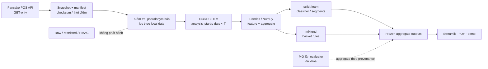

# Ma trận kiến trúc và luồng dữ liệu

## Các tầng

| Tầng | Công cụ/thành phần trong repo | Vai trò | Đầu vào → đầu ra | Giới hạn / vấn đề cần nhớ |
|---|---|---|---|---|
| 1. Thu nhận | Pancake POS REST API, `requests`, Python `json` | Lấy snapshot qua GET, phân trang, ghi manifest và checksum | API → trang snapshot + manifest | API chỉ GET; dữ liệu API phản ánh trạng thái hiện tại, không có lịch sử chuyển trạng thái đầy đủ |
| 2. Bảo vệ và kiểm tra | manifest SHA-256, bộ lọc/ẩn danh HMAC, kiểm tra khóa, tệp raw cách ly | Giữ provenance, khóa khách giả danh, phát hiện checksum/PII | Snapshot → kho được kiểm tra và khóa pseudonym | Raw/restricted và khóa HMAC không đưa vào gói chia sẻ; HMAC vẫn là dữ liệu hạn chế |
| 3. Kho và xử lý | DuckDB, Python, Pandas, NumPy | Kho sao hình sao, lọc thời gian/trạng thái, tạo feature và cohort DEV | DEV warehouse → bảng aggregate/feature DEV | Giai đoạn bán thử trước 2024-04-01 bị loại; trường tiền không nằm trong warehouse Day 1 |
| 4. Khai phá/mô hình | scikit-learn (pipeline, Logistic Regression, Decision Tree, Random Forest, K-Means), mlxtend (FP-Growth/association rules) | Phân loại quay lại, phân khúc RFM, luật kết hợp; validation theo thời gian | Feature/giỏ DEV → metric, mô hình và luật đã khóa | DBSCAN địa lý được cân nhắc nhưng không chạy vì thiếu tọa độ/mã vùng; association không phải quan hệ nhân quả; nhóm RFM là mô tả lịch sử, không gắn nhãn nguy cơ rời bỏ; evaluator không fit lại mô hình |
| 5. Trình bày và sử dụng | Streamlit, Matplotlib/PDF, CSV/JSON aggregate | Dashboard năm tab, báo cáo, demo và trao đổi kết quả | Aggregate outputs đã chọn → dashboard/report | Không gọi API hoặc đọc raw/test; không chia sẻ HMAC, nhãn từng khách hay dự đoán mức khách |

## Ma trận câu hỏi nghiệp vụ

| Câu hỏi | Dữ liệu | Phương pháp / kết quả | Metric hoặc cách đọc | Hạn chế |
|---|---|---|---|---|
| Mẫu mua có biến thiên theo thời gian không? | Đơn status 3 DEV, local date | Tổng hợp tháng, giỏ, frequency | Count, median, quantile; mô tả | Mùa vụ/đỉnh tháng chưa có kiểm định nguyên nhân |
| Khách có quay lại trong 180 ngày không? | Feature trước T và nhãn DEV | Temporal expanding validation; Logistic Regression chính | ROC-AUC, AP, precision, recall, F1, confusion matrix | Nhãn dương thưa; test có khác biệt ngày T đã công bố |
| Các kiểu RFM nào dễ mô tả? | Feature RFM DEV | K-Means/độ nhạy và nhóm quy tắc | Silhouette/độ ổn định, hồ sơ aggregate | Mô tả nhóm không phải xác suất quay lại hay nguy cơ rời bỏ |
| Sản phẩm nào hay đồng xuất hiện? | Giỏ status 3 DEV, loại quà theo quy tắc | FP-Growth và luật kết hợp | Support, confidence, lift; 24 combo ổn định theo biên bản | Không suy ra lợi nhuận hay tác động của bundle |
| Kết quả trình bày an toàn thế nào? | CSV/JSON aggregate chọn lọc | Dashboard 5 tab và report | Các tổng/metric đã chốt | Không có truy vấn trực tiếp API/raw/test trong giao diện |

## Sơ đồ

Sơ đồ mô tả thiết kế và artifact đã có. Dữ liệu test/khách hàng cấp dòng không đi vào dashboard hoặc gói chia sẻ.
